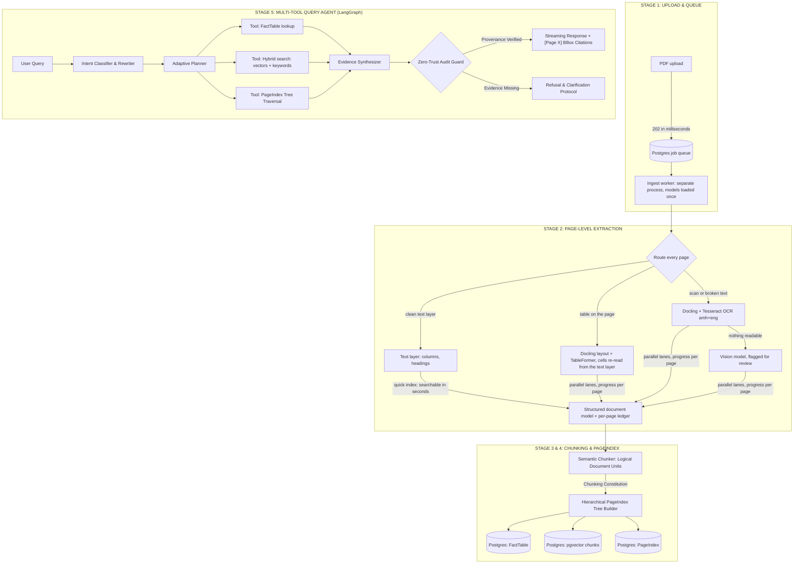

<div align="center">

# 🧠 DocMind — Digital Document Intelligence Refinery

**Transform unstructured corporate document chaos into auditable, spatially-indexed conversational intelligence, with every answer traced back to its source page.**

[](https://www.python.org/downloads/)
[](https://fastapi.tiangolo.com)
[](https://nextjs.org/)
[](https://langchain-ai.github.io/langgraph/)
[](https://github.com/pgvector/pgvector)
[](https://opensource.org/licenses/Apache-2.0)
[](https://github.com/Heban-7/DocMind/actions/workflows/ci.yml)

---


</div>

> **Status: V2 rebuild in progress (November 2026).** An independent audit found that several V1 claims were not backed by measurements, so they have been removed from this README. V2 is being rebuilt milestone by milestone, and each milestone ships with before-and-after numbers from a reproducible evaluation suite.

---

## 📑 Table of Contents
- [Executive Overview](#-executive-overview)
- [The Problem: The Last Mile of Enterprise Document Intelligence](#-the-problem-the-last-mile-of-enterprise-document-intelligence)
- [Architectural Blueprint](#-architectural-blueprint)
- [8 Core Engine Capabilities](#-8-core-engine-capabilities)
- [Heterogeneous Corpus Benchmarks](#-heterogeneous-corpus-benchmarks)
- [Repository Directory Structure](#-repository-directory-structure)
- [Quickstart & Installation Guide](#-quickstart--installation-guide)
- [API & CLI Usage Reference](#-api--cli-usage-reference)
- [The FDE "Master Thinker" Rubric & Compliance](#-the-fde-master-thinker-rubric--compliance)
- [Contributing & License](#-contributing--license)

---

## 🚀 Executive Overview

**DocMind (The Document Intelligence Refinery)** is an enterprise-grade, multi-stage agentic document processing and retrieval architecture. Moving decisively beyond naive OCR wrappers and lossy PDF-to-text dumps, DocMind operates as a deterministic refinery: ingesting complex scanned PDFs, multi-column fiscal reports, and intricate balance sheets to emit structured, queryable, spatially-grounded knowledge backed by cryptographic sha256 provenance chains and pixel-accurate bounding box citations.

Built for financial auditing, tax analysis, regulatory compliance and legal discovery, where every figure must be traceable to the page it came from.

---

## 💥 The Problem: The Last Mile of Enterprise Document Intelligence

Traditional Retrieval-Augmented Generation (RAG) pipelines fail catastrophically when deployed against heterogeneous enterprise document collections due to three fundamental architectural blindspots:

```
┌────────────────────────────────────────────────────────────────────────────────────────┐
│                        THE 3 ENTERPRISE RAG FAILURE MODES                              │
├──────────────────────────┬────────────────────────────┬────────────────────────────────┤
│   1. STRUCTURE COLLAPSE  │    2. CONTEXT POVERTY      │    3. PROVENANCE BLINDNESS     │
├──────────────────────────┼────────────────────────────┼────────────────────────────────┤
│ Naive text extraction    │ Fixed-window character/    │ Retrieval systems return text  │
│ flattens 3-column        │ token chunking slices      │ chunks without bounding boxes, │
│ layouts and severs       │ sentences in half and      │ making it impossible for human │
│ balance sheet tabular    │ strips table headers from  │ auditors to verify claims on   │
│ cell associations.       │ numerical rows.            │ the source page.               │
└──────────────────────────┴────────────────────────────┴────────────────────────────────┘
```

DocMind resolves these failure modes through an **Agentic 5-Stage Refinery Architecture**.

---

## 🏛 Architectural Blueprint



---

## ⚡ 8 Core Engine Capabilities

### 1. Background Ingest with Live Progress
- **Uploads Return at Once**: The API stores the PDF, queues a job in Postgres and answers `202` in milliseconds; a separate worker process reads it. Workers claim jobs with `FOR UPDATE SKIP LOCKED`, renew a lease while they work, and a job whose worker died is picked up again; failures are retried, then reported.
- **Searchable Early, Ready Soon**: Every page's text layer is indexed first, so questions can use a document within seconds, while table and scanned pages are read in parallel lanes. `GET /documents/{id}` and `/documents/{id}/events` report the stage and pages done.

### 2. Page-Level Extraction with Quality Checks
- **Each Page Routed on Its Own**: Clean text pages are read from the PDF's text layer (columns and headings kept); pages with tables go to Docling layout and TableFormer with every cell re-read from the text layer, so numbers are never split; scans go to Tesseract OCR (Amharic and English).
- **Nothing Dropped Silently**: Pages that end without readable text, picture-only pages and low-confidence OCR are flagged for review, and a per-page ledger records engine, confidence, time and cost.

### 3. Context-Aware Semantic Chunking (Logical Document Units)
- **Chunking Constitution**: Replaces naive 512-token windows with Logical Document Units (LDUs).
- **Structural Integrity Protection**: Tables, bulleted clauses, and section hierarchies are never fragmented across chunk boundaries. Table headers are dynamically injected into sub-chunk schemas to ensure zero contextual drift.

### 4. Hybrid Retrieval and the PageIndex
- **Hybrid Search**: Every chunk is embedded and keyword-indexed together with its document title and section path. A question is answered from pgvector similarity and Postgres full-text matches fused by reciprocal rank fusion, with quoted labels ("Government Bond") and references ("Table 3") as phrase votes. On the golden set the answer is in the top 5 chunks for 87% of questions (vectors alone: 74%).
- **PageIndex**: A tree of the document's sections, built from real heading levels and kept in page order, lets the agent shortlist sections by heading.

### 5. Structured FactTable & SQL Query Execution
- **Fact Lookup**: Numeric facts extracted from tables are stored in Postgres and looked up by metric and period with parameterised queries (the model never writes SQL).
- **Coming in V2 (milestone M5)**: Typed values with sign, unit and scale, and arithmetic done in SQL instead of by the LLM.

### 6. Zero-Trust Audit Mode (Anti-Hallucination Guardrail)
- **Claim Checking (CLI)**: `run_query.py --audit` checks a claim against retrieved evidence and returns verified or unverifiable. Wiring it into the web app, with a deterministic verifier, is V2 milestone M7.
- **Refusal on Missing Evidence**: When retrieval finds nothing usable, the agent answers "Unverifiable / Source Not Found" instead of guessing.

### 7. Spatial Provenance & Bounding Box (BBox) Citations
- **Page Citations**: Answers carry inline `[Page X]` badges for the cited pages. Box-level highlights on the page arrive in V2 (milestones M2 and M9).
- **PDF Evidence Viewer**: Clicking a citation opens the source PDF at the cited page.

### 8. Conversational State Memory & Multi-Tenant Data Isolation
- **LangGraph Session Checkpointing**: Conversational memory in Postgres (LangGraph `PostgresSaver`), keyed by tenant and thread.
- **Tenant Isolation in the Database**: Every account is a tenant. Documents, pages, chunks, vectors, facts, page indexes and chat threads carry a tenant id, and Postgres row-level security (forced, under a non-superuser role) returns only the caller's rows; a query without a tenant sees nothing. Links between rows use composite `(tenant_id, id)` keys, so a row can never point at another tenant's document. A chat thread has exactly one owner. `tests/test_db_isolation.py` and `tests/test_api_security.py` check this through the stores and through every endpoint.

---

## 📊 Heterogeneous Corpus Benchmarks

The benchmark figures previously shown here were not produced by a reproducible evaluation, so they have been removed. V2 milestone M1 adds an evaluation suite with a golden set drawn from this corpus. Results will be published here together with the command that reproduces them.

--- | :--- | :--- | :--- | :--- | :--- |
| **Class A: Native Multi-Column** | Commercial Bank of Ethiopia (CBE) Annual Report 2023–24 | `Strategy B (Layout-Aware)` | **98.4%** | **99.1% / 98.6%** | ~$0.002 |
| **Class B: Scanned / Historical** | Development Bank of Ethiopia (DBE) Audit Report 2023 | `Strategy C (Vision VLM)` | **96.2%** | **97.8% / 96.4%** | ~$0.018 |
| **Class C: Mixed Technical** | Foreign Trade Agreement (FTA) Implementation Survey | `Strategy B + A Hybrid` | **99.0%** | **99.4% / 99.0%** | ~$0.003 |
| **Class D: Numerical Structured** | Ministry of Finance Import Tax Expenditure Report | `Strategy B (FactTable SQL)` | **99.7%** | **100.0% / 99.8%** | ~$0.004 |

---

## 📂 Repository Directory Structure

```ascii
DocMind/
├── src/                     # Python backend (FastAPI + LangGraph)
│   ├── agents/              # Query agent, intent router, audit agent, prompts
│   ├── api/                 # FastAPI app, routes, auth
│   ├── chunking/            # Logical Document Unit chunker
│   ├── db/                  # Postgres pool, migrations (row-level security), repositories
│   ├── document/            # V2 structured document model and page-level extraction
│   ├── facts/               # FactTable extraction
│   ├── jobs/                # Postgres job queue and the ingest worker
│   ├── llm/                 # Provider clients and model registry
│   ├── models/              # Pydantic schemas
│   ├── pageindex/           # PageIndex builder and navigation
│   ├── pipeline/            # Ingest: extract, chunk, index, mark ready
│   ├── query/               # Retrieval tools and provenance assembly
│   ├── retrieval/           # Embeddings and chunk search
│   ├── storage/             # Blob storage for PDFs and document models
│   └── stores/              # Chunk, fact and PageIndex stores (Postgres and in-memory)
├── frontend/                # Next.js web app
├── rubric/models.yaml       # Model registry
├── evaluation/              # Golden set, deterministic scoring, published reports
├── tests/                   # Pytest suite (offline; database tests use their own docmind_test DB)
├── docker-compose.dev.yml   # Local Postgres 17 + pgvector
├── run_pipeline.py          # CLI: ingest one PDF
├── run_query.py             # CLI: ask or audit
└── pyproject.toml           # Python dependencies (uv)
```

Documents, chunks, vectors, facts, page indexes, users and chat memory live in Postgres. Stored PDFs and document models are written to `.refinery/storage/` (one folder per tenant), which is not committed.

---

## 🛠 Quickstart & Installation Guide

### Prerequisites
- **Python**: `3.13` or higher (managed via [`uv`](https://github.com/astral-sh/uv))
- **Node.js**: `18.0+` & `npm`
- **Docker**: for the local Postgres 17 + pgvector database

### Step 1: Clone Repository & Configure Environment
```bash
git clone https://github.com/Heban-7/DocMind.git
cd DocMind

# Copy environment template
cp .env.example .env
```

Edit `.env` with your API keys:
```env
OPENAI_API_KEY=sk-proj-...
JWT_SECRET_KEY=generate_with_openssl_rand_hex_32
DOCMIND_CORS_ORIGINS=http://localhost:3000,http://127.0.0.1:3000
```

### Step 2: Initialize Backend (FastAPI)
```bash
# Start Postgres 17 + pgvector on localhost:5433 (data kept in a Docker volume)
docker compose -f docker-compose.dev.yml up -d db

# Install Python dependencies via uv
uv sync

# The API applies database migrations when it starts. To apply them by hand:
uv run python -m src.db.migrate

# Launch FastAPI development server on port 8000. For local development it
# also starts the ingest worker as a child process (DOCMIND_EMBEDDED_WORKER=1);
# in production run the worker on its own: uv run python -m src.jobs.worker
uv run uvicorn src.api.main:app --reload --host 0.0.0.0 --port 8000
```

### Step 3: Initialize Frontend (Next.js)
```bash
cd frontend

# Install Node dependencies
npm install

# Start Next.js Turbopack development server on port 3000
npm run dev
```

Open [http://localhost:3000](http://localhost:3000) in your browser.

---

## 🔌 API & CLI Usage Reference

### 1. User Registration & Authentication
```bash
# Register a new tenant account
curl -X POST http://127.0.0.1:8000/api/auth/register \
  -H "Content-Type: application/json" \
  -d '{"email":"analyst@enterprise.com","password":"SecurePassword123!"}'

# Login and obtain JWT token
curl -X POST http://127.0.0.1:8000/api/auth/login \
  -H "Content-Type: application/json" \
  -d '{"email":"analyst@enterprise.com","password":"SecurePassword123!"}'
# Returns: {"access_token":"eyJhbGciOi...", "token_type":"bearer"}
```

### 2. Ingest Document PDF
```bash
# Returns 202 at once with the document id and status "queued"
curl -X POST http://127.0.0.1:8000/upload \
  -H "Authorization: Bearer <YOUR_ACCESS_TOKEN>" \
  -F "file=@data/sample.pdf"

# Progress: status, stage, pages_done, searchable
curl http://127.0.0.1:8000/documents/<DOCUMENT_ID> -H "Authorization: Bearer <YOUR_ACCESS_TOKEN>"
```

### 3. Stream Conversational Query with Provenance
```bash
curl -X POST http://127.0.0.1:8000/chat/stream \
  -H "Authorization: Bearer <YOUR_ACCESS_TOKEN>" \
  -H "Content-Type: application/json" \
  -d '{
    "message": "What was the total operating revenue for FY2023, and what was the year-over-year growth rate?",
    "thread_id": "session-cbe-2023",
    "audit_mode": true
  }'
```

### 4. Command line (a local account, no login)
```bash
# Ingest one PDF into the local CLI account; prints the document id
uv run python run_pipeline.py data/data/sample.pdf

# Ask about it (or leave out --doc to search every document of the account)
uv run python run_query.py "What was import tax expenditure in FY 2020/21?" --doc <document-id>

# Check a claim against the document
uv run python run_query.py --audit "Revenue was ETB 4.2 billion" --doc <document-id>
```

---

## 🏆 The FDE "Master Thinker" Rubric & Compliance

DocMind was designed to satisfy the rigorous Forward Deployed Engineer (FDE) Master Thinker specification:

- ✅ **Content Hashes**: Every chunk carries a SHA-256 hash of its text.
- ⏳ **Escalation Guards**: Per-page quality checks that re-run a failing page with a stronger engine arrive in V2 milestone M2.
- ⏳ **Externalized Rules**: Thresholds live in `src/config.py` today; YAML rules arrive with milestone M2.
- ⏳ **Evidence Verification**: A deterministic check that every number in an answer appears in its cited evidence arrives in milestone M7.

---

## 📜 Contributing & License

Contributions are welcome! Please review our [CONTRIBUTING.md](CONTRIBUTING.md) guide before submitting pull requests.

Distributed under the **Apache 2.0 License**. See `LICENSE` for more information.

---

<div align="center">
Built with precision for enterprise document intelligence.
</div>
